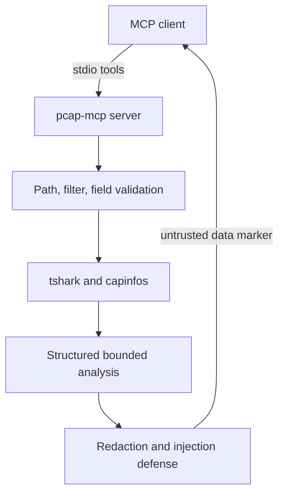

# pcap-mcp

> A secure MCP server that lets AI assistants investigate packet captures through Wireshark's
> `tshark` engine.

`pcap-mcp` provides 12 bounded network-analysis tools for protocol inventory, TCP failure
diagnosis, latency measurement, and threat hunting. Its defining assumption is that every byte
decoded from a capture is untrusted, attacker-controlled input.

## Capabilities

| Tool | Use it for |
| --- | --- |
| `summarize_capture` | Start an investigation with metadata, protocol distribution, and talkers |
| `list_conversations` | Rank TCP, UDP, or IP conversations by bytes |
| `inspect_dns_queries` | Review queried names, response codes, and frequency |
| `inspect_http_requests` | Inspect bounded HTTP request metadata |
| `show_protocol_hierarchy` | See the complete decoded protocol mix |
| `find_tcp_anomalies` | Diagnose retransmissions, reordering, zero windows, and duplicate ACKs |
| `analyze_handshake_failures` | Distinguish RST/refused connections from silent timeouts |
| `measure_rtt` | Measure min, median, p95, maximum RTT and jitter |
| `detect_suspicious_patterns` | Find port-scan, periodic beacon, and DNS-tunnel leads |
| `check_tls_posture` | Inventory TLS versions and highlight obsolete protocols |
| `find_cleartext_credentials` | Locate likely credentials without returning their values |
| `run_display_filter` | Run a bounded custom Wireshark display filter and field extraction |

## Architecture



The project delegates protocol decoding to Wireshark. Python owns the boundaries that matter for
an agent: process isolation, strict inputs, bounded structured output, redaction, and prompt-
injection defense.

## Windows installation

1. Install the Windows x64 build of Wireshark. Include Npcap if you also want to capture traffic.
2. Open PowerShell in this repository and install the project:

   ```powershell
   uv venv
   .\.venv\Scripts\Activate.ps1
   uv pip install -e ".[dev]"
   tshark -v
   pytest -v
   ```

3. Add the server to `%APPDATA%\Claude\claude_desktop_config.json`. JSON backslashes must be
   doubled:

   ```json
   {
     "mcpServers": {
       "pcap": {
         "command": "D:\\projects\\pcap-mcp\\.venv\\Scripts\\python.exe",
         "args": ["-m", "pcap_mcp.server"],
         "env": {
           "PCAP_MCP_ALLOWED_DIRS": "D:\\pcaps",
           "PCAP_MCP_REDACT": "on",
           "PCAP_MCP_MAX_FILE_MB": "200",
           "PCAP_MCP_MAX_ROWS": "200",
           "PCAP_MCP_TIMEOUT_S": "60"
         }
       }
     }
   }
   ```

4. Fully quit and reopen Claude Desktop. Ask it to summarize a capture under the allowed path.

Multiple allowed directories use the Windows path separator (`;`), for example
`D:\pcaps;E:\incident-captures`.

## Security model

Capture fields such as HTTP bodies, URIs, User-Agent values, DNS names, and TLS SNI are controlled
by network peers. They may contain instructions intended for the AI rather than meaningful packet
data. An injection can attempt data theft, call another connected tool, or—more subtly—make the
assistant declare hostile traffic clean.

The server uses three layers:

1. **Input boundary:** strict real paths, deny-by-default directories, capture suffix and size
   limits, validated filters/fields/statistics, no shell, and subprocess timeouts.
2. **Information boundary:** bounded output with explicit `truncated` metadata, default IP/MAC and
   secret redaction, and no credential-value extraction.
3. **Model boundary:** prompt-injection feature detection, Unicode control removal, neutralized
   matching text, a mandatory warning, and `<untrusted_pcap_data>` wrapping.

The full threat table and residual risks are in [docs/SECURITY.md](docs/SECURITY.md). The included
`tests/fixtures/injection_demo.pcap` is a reproducible defensive fixture generated by
`scripts/craft_injection_pcap.py`.

### Redaction philosophy

Redaction preserves analysis value while reducing identifiability. IPv4 output retains the first
three octets so private/external network relationships remain visible, while removing the host
octet. MAC output retains the vendor OUI. Domains remain visible because they are often essential
threat indicators. Disable redaction only in a controlled environment with
`PCAP_MCP_REDACT=off`.

## Development

```powershell
ruff check src tests scripts
pytest -v --cov=src --cov-report=term-missing
python scripts\craft_injection_pcap.py
```

Pure unit tests mock the tshark boundary. Tests marked `integration` require a local Wireshark
installation and suitable fixture captures.

## OpenAI-compatible API client

The optional terminal client connects an OpenAI-compatible model API to this local MCP server.
The provider must support Chat Completions function/tool calling. Keep API keys in environment
variables, never in source files or Inspector configuration:

```powershell
$env:OPENAI_API_KEY = "your-key"
$env:OPENAI_BASE_URL = "https://provider.example/v1"
$env:OPENAI_MODEL = "provider-model-name"
$env:PCAP_MCP_ALLOWED_DIRS = "D:\pcaps;D:\projects\pcap-mcp\tests\fixtures"
$env:PCAP_MCP_REDACT = "on"
python scripts\openai_mcp_client.py
```

The model selects among the 12 MCP tools, the client executes them locally, and only guarded tool
results are returned to the API. Those results can still contain capture-derived metadata, so
review the third-party provider's retention and privacy terms before using sensitive captures.

## Troubleshooting

- **The MCP process immediately exits:** run `.venv\Scripts\python.exe -m pcap_mcp.server` in a
  terminal. Waiting silently for stdio is normal; a traceback is not.
- **Claude cannot connect:** validate the JSON, check doubled backslashes, confirm `python.exe`
  exists, then inspect `%APPDATA%\Claude\logs\mcp-server-pcap.log`.
- **The connection breaks after adding debug output:** never `print()` from server code. MCP stdio
  uses standard output for protocol messages; log to standard error or a file.
- **A path is refused:** set `PCAP_MCP_ALLOWED_DIRS` to a parent directory and restart the client.
- **Text looks corrupted:** the subprocess layer forces UTF-8 and replaces undecodable bytes.

## Known limitations

- Threat findings and injection detection are heuristics with possible false positives and misses.
- Redaction is best-effort, not a data-loss-prevention product.
- Encrypted payloads are not decrypted; TLS key-log support is not implemented.
- The server analyzes existing captures only and does not perform live capture.
- Conversation ranking scans at most 20,000 matching packets and reports `truncated=true` when
  that bound is reached.

## License

MIT
