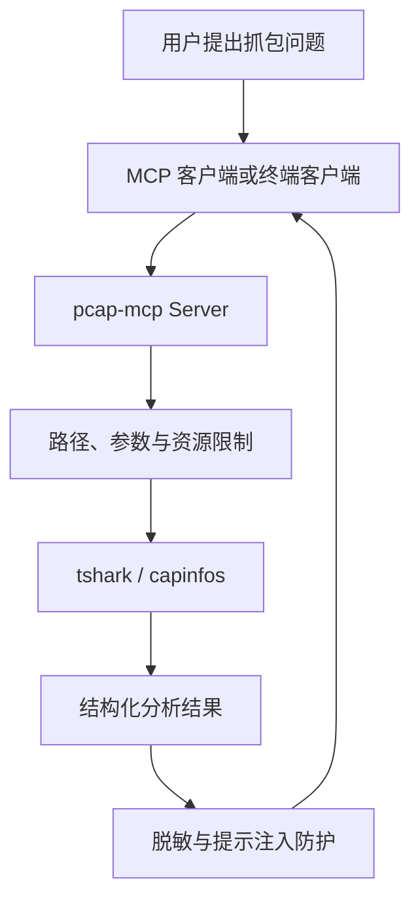

# pcap-mcp

> 一个面向 Windows 的安全型网络抓包分析 MCP Server：让 AI 通过 Wireshark `tshark`
> 分析 `.pcap/.pcapng` 文件，同时尽量避免路径越权、敏感信息泄露和提示注入。

`pcap-mcp` 提供 12 个有边界的网络分析工具，覆盖协议统计、DNS/HTTP/TLS 检查、
TCP 故障定位、RTT 分布和可疑流量线索。项目最重要的设计假设是：
**抓包中解析出的任何文本都可能由攻击者控制，不能直接当成 AI 指令。**

## 项目能做什么

- 用自然语言让 AI 调用本地抓包分析工具。
- 分析 IPv4、IPv6 和 VLAN 流量。
- 区分 TCP 握手成功、RST 拒绝和 SYN 无响应。
- 检查重传、乱序、重复 ACK、零窗口等 TCP 现象。
- 汇总 DNS、HTTP、TLS、会话和主要通信端点。
- 检测端口扫描、周期性 Beacon、DNS 隧道等启发式线索。
- 定位可能存在明文凭据的帧，但绝不返回凭据内容。
- 默认脱敏 IP、MAC 和常见敏感字段。
- 检测并中和抓包载荷中的提示注入文本。

## 工作流程



AI 只负责选择工具和解释结构化结果；协议解析由 Wireshark 完成。Python 层主要负责：

1. 限制文件、参数、运行时间和输出规模；
2. 将 tshark 结果整理成有边界的 JSON 数据；
3. 在结果发送给模型前执行脱敏和提示注入防护。

## 12 个分析工具

| 工具 | 用途 | 典型问题 |
| --- | --- | --- |
| `summarize_capture` | 文件元数据、协议汇总、主要端点 | “先概览这个抓包” |
| `list_conversations` | 按字节数排列 TCP/UDP/IP 会话 | “主要是谁在通信？” |
| `inspect_dns_queries` | DNS 名称、响应码和频率 | “有没有异常 DNS？” |
| `inspect_http_requests` | HTTP 方法、Host、URI、User-Agent | “访问了哪些网站？” |
| `show_protocol_hierarchy` | 完整协议层次与跨 VLAN 汇总 | “抓包里有哪些协议？” |
| `find_tcp_anomalies` | 重传、乱序、重复 ACK、零窗口 | “为什么网络不稳定？” |
| `analyze_handshake_failures` | 区分成功、RST 拒绝和无响应 | “为什么连不上端口？” |
| `measure_rtt` | ACK RTT 的分布和离散程度 | “延迟是否存在长尾？” |
| `detect_suspicious_patterns` | 扫描、Beacon、DNS 隧道线索 | “有没有可疑流量？” |
| `check_tls_posture` | TLS 版本、SNI、旧版本告警 | “TLS 配置是否过时？” |
| `find_cleartext_credentials` | 只报告疑似凭据所在帧 | “是否存在明文密码？” |
| `run_display_filter` | 安全执行自定义显示过滤器 | “提取指定帧和字段” |

> `measure_rtt` 使用 Wireshark 的 `tcp.analysis.ack_rtt`。返回的 `jitter_ms` 是这些 ACK RTT
> 样本的标准差，不等同于语音或视频协议中的 RTP jitter。

## Windows 安装

### 1. 安装基础环境

需要：

- Python 3.11 或更高版本
- [uv](https://docs.astral.sh/uv/)
- Git
- Wireshark（安装时建议同时安装 Npcap）
- VS Code（可选）

如果 Wireshark 安装在 `D:\Program Files\Wireshark`，当前 PowerShell 会话可这样配置：

```powershell
$env:Path = "D:\Program Files\Wireshark;$env:Path"
tshark -v
capinfos -v
```

### 2. 克隆并安装项目

```powershell
git clone https://github.com/你的用户名/pcap-mcp.git
Set-Location pcap-mcp

uv sync --extra dev
.\.venv\Scripts\Activate.ps1
pytest -q
```

测试成功时应看到：

```text
28 passed
```

## 安全配置

服务默认拒绝读取任何抓包。使用前必须设置允许目录：

```powershell
$env:PCAP_MCP_ALLOWED_DIRS = "D:\pcaps;D:\projects\pcap-mcp\tests\fixtures"
$env:PCAP_MCP_REDACT = "on"
$env:PCAP_MCP_MAX_FILE_MB = "200"
$env:PCAP_MCP_MAX_ROWS = "200"
$env:PCAP_MCP_TIMEOUT_S = "60"
```

多个允许目录在 Windows 上使用分号 `;` 分隔。

## 使用 MCP Inspector 测试

Inspector 只用于调试 MCP 工具，不需要模型 API：

```powershell
$env:Path = "D:\Program Files\nodejs;D:\Program Files\Wireshark;$env:Path"

npx.cmd -y @modelcontextprotocol/inspector `
  "D:\projects\pcap-mcp\.venv\Scripts\python.exe" `
  -m pcap_mcp.server
```

浏览器打开终端给出的本地地址，连接后可以直接调用 12 个工具。例如：

- 工具：`summarize_capture`
- 参数：`{"path":"D:\\pcaps\\samples\\sample.pcapng"}`

## 使用 OpenAI 兼容 API

项目附带 `scripts/openai_mcp_client.py`。只要服务商支持 Chat Completions 的工具调用格式，
就可以让模型自动选择本地 MCP 工具。

```powershell
$env:OPENAI_API_KEY = "你的API密钥"
$env:OPENAI_BASE_URL = "https://你的服务商地址/v1"
$env:OPENAI_MODEL = "你的模型名称"

$env:PCAP_MCP_ALLOWED_DIRS = "D:\pcaps;D:\projects\pcap-mcp\tests\fixtures"
$env:PCAP_MCP_REDACT = "on"

python scripts\openai_mcp_client.py
```

终端显示以下内容即表示连接成功：

```text
Connected: 12 pcap tools; model=你的模型名称
```

客户端目前采用“一行一条消息”的交互方式。请把完整问题粘贴为一行后再按回车，例如：

```text
请全面分析 D:\pcaps\samples\sample.pcapng，先概览协议和会话，再检查 DNS、HTTP、TLS、TCP 异常、握手、RTT、可疑模式及明文凭据；明确区分事实和启发式判断，并说明 truncated 状态。
```

API 密钥只应通过环境变量设置，不要写进源码、README、Inspector 配置或提交到 Git。

## 提示注入防护演示

仓库包含一个可复现的防御测试样本：

```text
tests/fixtures/injection_demo.pcap
```

该抓包的 HTTP 载荷中包含指令覆盖、角色重置和 Unicode 控制字符。运行：

```text
请对 D:\projects\pcap-mcp\tests\fixtures\injection_demo.pcap 调用 run_display_filter，过滤器使用 tcp.srcport == 80，提取 frame.number,tcp.payload，并检查是否存在提示注入风险。
```

服务会：

1. 将载荷作为不可信网络数据处理；
2. 检测提示注入特征和 Unicode 控制字符；
3. 中和危险回显；
4. 返回强制安全警告；
5. 不执行载荷中的任何指令。

可重新生成测试样本：

```powershell
python scripts\craft_injection_pcap.py
```

## 安全模型

抓包中的 HTTP body、URI、User-Agent、DNS 名称和 TLS SNI 都可能由网络对端控制。
恶意内容不仅可能诱导 AI 读取或泄露文件，也可能要求 AI 隐瞒告警、把恶意流量描述成正常流量。

项目使用三层防护：

### 1. 输入边界

- `PCAP_MCP_ALLOWED_DIRS` 未配置时拒绝读取所有文件；
- 解析真实路径，限制允许目录和抓包后缀；
- 限制文件大小、输出行数和子进程运行时间；
- 校验显示过滤器、字段名和统计模块；
- 使用参数列表启动 tshark，`shell=False`。

### 2. 信息边界

- 输出规模有上限，并返回明确的 `truncated` 状态；
- 默认对 IPv4、IPv6、MAC 和常见敏感字段脱敏；
- 明文凭据工具只报告帧号和协议，不提取凭据内容；
- 向第三方 API 发送的只是经过防护的工具结果，而不是原始抓包文件。

### 3. 模型边界

- 检测指令覆盖、角色重置、提示词泄露等特征；
- 清除零宽字符和双向文本控制字符；
- 中和匹配到的危险文本；
- 使用 `<untrusted_pcap_data>` 标记工具输出；
- 命中风险时强制添加安全告警。

完整威胁表和剩余风险见 [docs/SECURITY.md](docs/SECURITY.md)。

## 脱敏原则

脱敏目标是“保留分析价值，降低可识别性”：

- IPv4 保留网段信息，隐藏主机位；
- IPv6 隐藏后半部分地址；
- MAC 保留厂商 OUI，隐藏设备部分；
- 域名通常保留，因为它们可能是关键威胁指标；
- Authorization、Cookie 等敏感值会被替换。

`PCAP_MCP_REDACT=off` 只应在隔离、受控且确有需要的环境中使用。

## 开发与测试

```powershell
ruff check src tests scripts
pytest -v --cov=src --cov-report=term-missing
mypy src scripts\openai_mcp_client.py
```

当前测试覆盖：

- 目录白名单和路径限制；
- 文件类型及大小限制；
- 显示过滤器和字段校验；
- IPv4/IPv6/VLAN 协议汇总；
- TCP 会话、握手、RTT 和凭据定位；
- 脱敏、提示注入和 Unicode 控制字符；
- OpenAI 工具格式转换和结果上限。

## 项目结构

```text
pcap-mcp/
├─ .github/workflows/ci.yml       # GitHub Actions
├─ docs/SECURITY.md               # 详细安全模型
├─ scripts/
│  ├─ craft_injection_pcap.py     # 构造安全测试抓包
│  └─ openai_mcp_client.py        # OpenAI 兼容终端客户端
├─ src/pcap_mcp/
│  ├─ analysis.py                 # 12 个工具的分析逻辑
│  ├─ config.py                   # 环境变量配置
│  ├─ security.py                 # 脱敏与注入防护
│  ├─ server.py                   # MCP Server
│  └─ tshark.py                   # 安全的 tshark 子进程边界
├─ tests/                         # 单元测试与安全样本
├─ pyproject.toml
└─ README.md
```

## 常见问题

### `PCAP_MCP_ALLOWED_DIRS is not configured`

这是安全默认行为。设置允许目录后，必须重启 Inspector 或客户端，使新 MCP Server 继承环境变量。

### PowerShell 找不到 `node` 或 `npx`

```powershell
$env:Path = "D:\Program Files\nodejs;$env:Path"
node -v
npx.cmd -v
```

### 找不到 `tshark`

```powershell
$env:Path = "D:\Program Files\Wireshark;$env:Path"
tshark -v
```

### 执行 `python -m pcap_mcp.server` 后一直没有输出

这是正常现象。MCP stdio Server 会等待客户端通过标准输入发送协议消息。

### 服务添加调试输出后断开

不要在 MCP Server 中随意 `print()`。stdout 是 MCP 协议通道，调试日志应写入 stderr 或文件。

### OpenAI 兼容 API 报 `Invalid token`

检查密钥是否在当前 PowerShell 会话中正确设置，并确认密钥属于当前 API 服务商。不要在聊天、截图或 GitHub 中公开密钥。

## 已知限制

- 可疑流量和提示注入检测都是启发式规则，存在误报和漏报；
- TLS 加密载荷不会被解密，尚未支持 TLS key log；
- 只分析已有抓包，不负责实时抓取；
- 会话排行最多扫描 20,000 个匹配包，达到上限时返回 `truncated=true`；
- ACK RTT 统计会受延迟确认、抓包位置、网卡卸载和混合会话影响；
- 默认脱敏是降低风险的措施，不是完整的数据防泄漏产品。

## License

MIT
