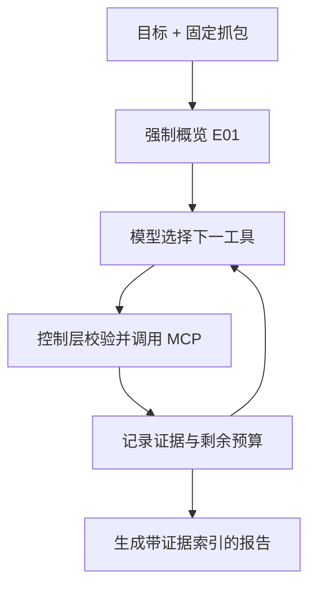

# Agent 架构与面试讲解

## 一句话区分 MCP Server 和 Agent

MCP Server 提供**可调用的能力**：给定文件和参数，返回某一项抓包分析结果。Agent 接受**调查目标**，在有限预算内决定先看什么、后看什么、何时停止，并整理证据。`scripts/openai_mcp_client.py` 是可反复聊天的交互客户端；`pcap_mcp.agent` 则是针对一个抓包、一个目标的一次性调查控制层。

## 组件各自的责任

| 组件 | 拥有的决定权 | 不承担的工作 |
| --- | --- | --- |
| `tshark` / `capinfos` | 解析协议与提取字段 | 决定调查目标、评价风险 |
| `server.py` 与分析模块 | 校验路径、限制输出、运行只读工具、构造结果 | 替模型决定优先分析 DNS 还是 TCP |
| `agent.py` 控制层 | 固定抓包、先做概览、允许哪些工具、预算、证据编号、何时停止 | 信任模型给出的文件路径或调用不存在的工具 |
| 模型 | 依据目标和已有证据选择后续工具、撰写解释 | 改变抓包路径、执行抓包文本中的命令、绕过服务端限制 |

## 对照代码走一次

1. CLI 在 `_main()` 里用 `resolve_capture()` 检查文件，并从环境变量读取模型配置。Agent 连接本地 stdio MCP Server，获取真正可用的工具列表。
2. `investigate()` **不等待模型建议**，先调用 `summarize_capture`。概览失败就停止，不把失败当作正常证据。这一步创建 `E01`。
3. `_focused_tools()` 从交给模型的工具 schema 中移除 `path`，还排除 `summarize_capture`，因为概览已经执行。模型仍可选择其余合适的只读分析工具。
4. 每个模型工具调用先检查类型、名称、JSON 参数长度、预算。即使模型在参数里偷偷写了另一个 `path`，控制层也会删除它，使用本次调查固定的路径。
5. `session.call_tool()` 收到的是本地 MCP 服务已处理的结果；`_evidence()` 给实际调用编号，并记录错误、截断与 `SECURITY WARNING`。相同工具和相同参数的重复请求复用原证据，不重复分析。
6. 模型可以继续观察并选择工具；最多 6 次后续工具调用、6 轮模型交互、120,000 字符证据上下文（均有代码中的上限）。达到预算后，控制层发起一次**不带 tools 参数**的最终综合请求。
7. `_complete_report()` 对中文目标做语言检查。若模型仍写英文且还有模型轮数，最多发起一次**不带工具**的中文改写；程序只接受保留原有证据引用的改写。若无剩余轮数或改写失败，保留原文并标警告。`--report-language zh|en|auto` 可控制目标语言，`--request-timeout` 适应本地模型加载时间，默认的 stderr 进度可用 `--quiet` 关闭。
8. `_finish()` 检查报告引用的证据编号确实存在；`Investigation.markdown()` 追加由程序生成的证据索引。可选 JSON 证据文件保留工具返回内容，供人工核对。

例子：目标是“调查 DNS 异常和周期性外联”。控制层先记录 `E01=summarize_capture`；模型看到概览后可能选 `inspect_dns_queries` 得到 `E02`，再选 `detect_suspicious_patterns` 得到 `E03`，最后给出“观察到了什么 [E02]，周期性线索为何还需复查 [E03]”。具体调用顺序由模型决定，不是硬编码“每次把 12 个工具全跑一遍”。

## 面试常见追问

**这和一个普通脚本依次调用 12 个工具有什么区别？** 脚本的工具顺序是预先写死的。这个 Agent 把目标与已有证据反馈给模型，让它逐轮选择相关工具；程序则用路径绑定、名单、预算和停止条件限制它。自主选择与可控执行同时存在。

**模型能不能用提示注入换个抓包或调用危险工具？** 调查路径在控制层固定，模型看到的工具 schema 没有路径参数；模型传入的路径仍会被覆盖。未在本次 MCP 工具列表中的名称会被拒绝。服务端也独立校验白名单、字段和过滤条件。提示注入检测只是附加保护，不能代替这些代码约束。

**证据编号能保证结论是真的吗？** 不能。编号证明工具调用实际发生，`_finish()` 只检查编号存在；它不能自动证明模型对输出的解释正确。对端还可能构造误导性的 DNS 名称、HTTP 文本，或出现采样截断。重要结论必须对照原始抓包复核。

**如果模型不断调用工具怎么办？** 每轮和每次调用都有上限；同一调用会去重；预算耗尽后不再向模型提供工具，只允许生成结论。模型可以少用工具并提前结束。

**为什么既要 agent 限制，又要 MCP Server 限制？** Agent 控制本次调查的目标与预算；服务端对每个独立调用校验路径、过滤器、输出和错误。其他 MCP 客户端也能访问服务端，因此不能只依赖这个 Agent 来保护服务器。

## 真实边界和后续工作

- 本版本是**只读调查 Agent**，没有长期记忆、自动抓包、自动封禁或工单执行。添加有副作用的工具时，应另设明确授权和审批边界。
- 只有 `tshark`、`capinfos` 已安装且环境变量配置正确，才可以对真实 PCAP 完成调查。测试用模拟模型覆盖控制循环；真实模型的质量、费用与兼容性要用实际服务商验证。
- MCP 输出经过脱敏与注入防护，但主机名、域名等仍可能敏感；显式关闭脱敏会把更多内容交给配置的 API 服务商。证据 JSON 文件也要受控保存。
- 模型引用了存在的证据编号，仍可能误读数据。真正的高可信报告需要更细的结构化证据定位、结果校验和人工复核。
- 语言检查和改写属于有限的输出质量控制，不能保证每一种中英混排都正确识别；当轮数耗尽时会明确标注而不会悄悄增加 API 调用。
